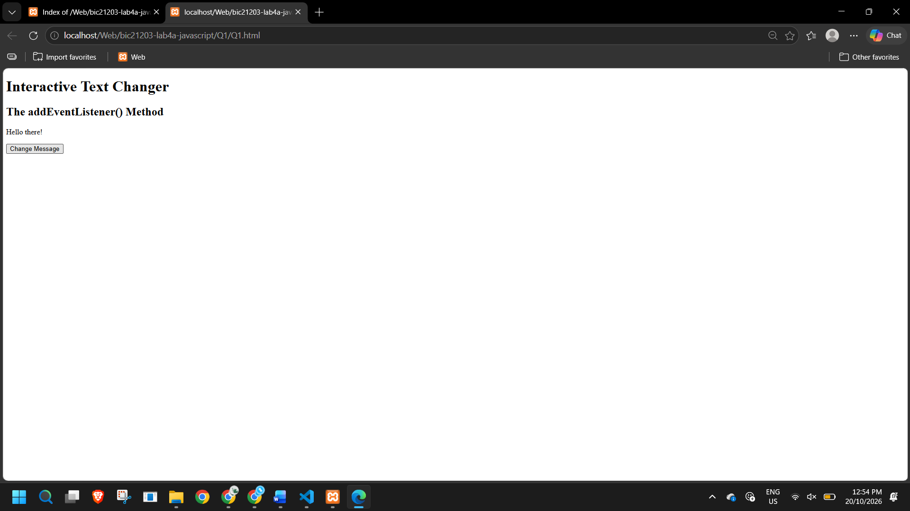
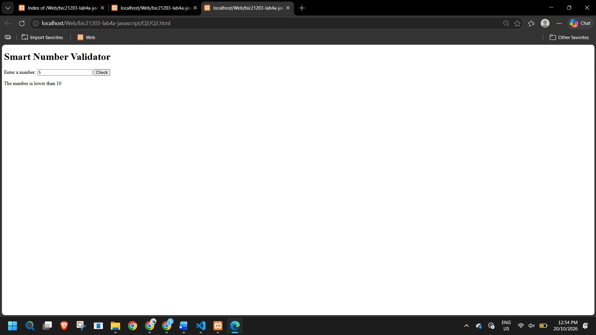
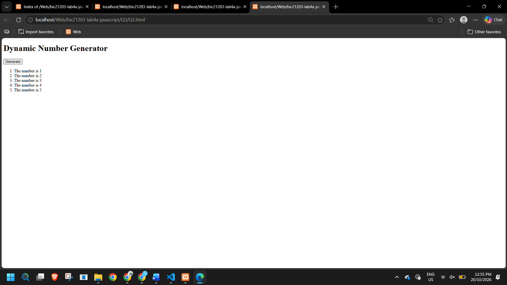

# Lab 4a: Client-Side Scripting (JavaScript)

Name:Deeviya A/P Vigneswaran  
Matric Number: CI240037
Course Code: BIC21203

## Introduction
This lab demonstrates the use of JavaScript functions, events, conditions, input validation, loops and DOM manipulation to create interactive webpages.

## Question 1: Interactive Text Changer
The webpage changes the message from "Welcome to my website!" to "Hello there!" when the user clicks the Change Message button.

## Question 2: Smart Number Validator
The webpage checks the number entered by the user and displays whether it is lower than, higher than or equal to 10. It also handles empty and invalid inputs.

## Question 3: Dynamic Number Generator
The webpage generates an ordered list containing numbers 1 to 5 using a for loop. Repeated clicks do not create duplicate list items.

## How to Run
1. Open the Q1, Q2 or Q3 folder in this repository.
2. Open the corresponding HTML file.
3. Download the file and open it in a desktop web browser.
4. Click the buttons and test the output.

## Screenshots
Q1

Q2

Q3

## Reflection
Through this lab, I learned how to use JavaScript to make webpages interactive. I practised using functions and event listeners to respond to button clicks. I also learned how to validate user input using if...else statements and generate list items using a for loop. This lab helped me understand how DOM methods can change webpage content dynamically.
